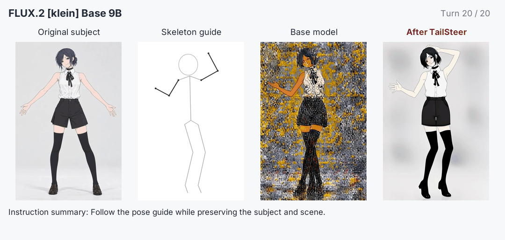
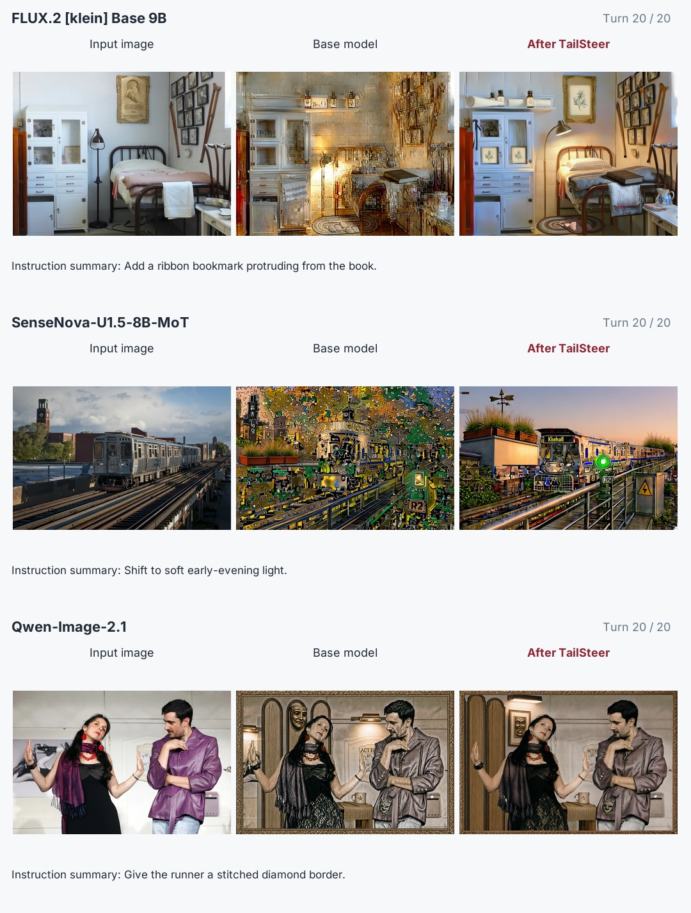
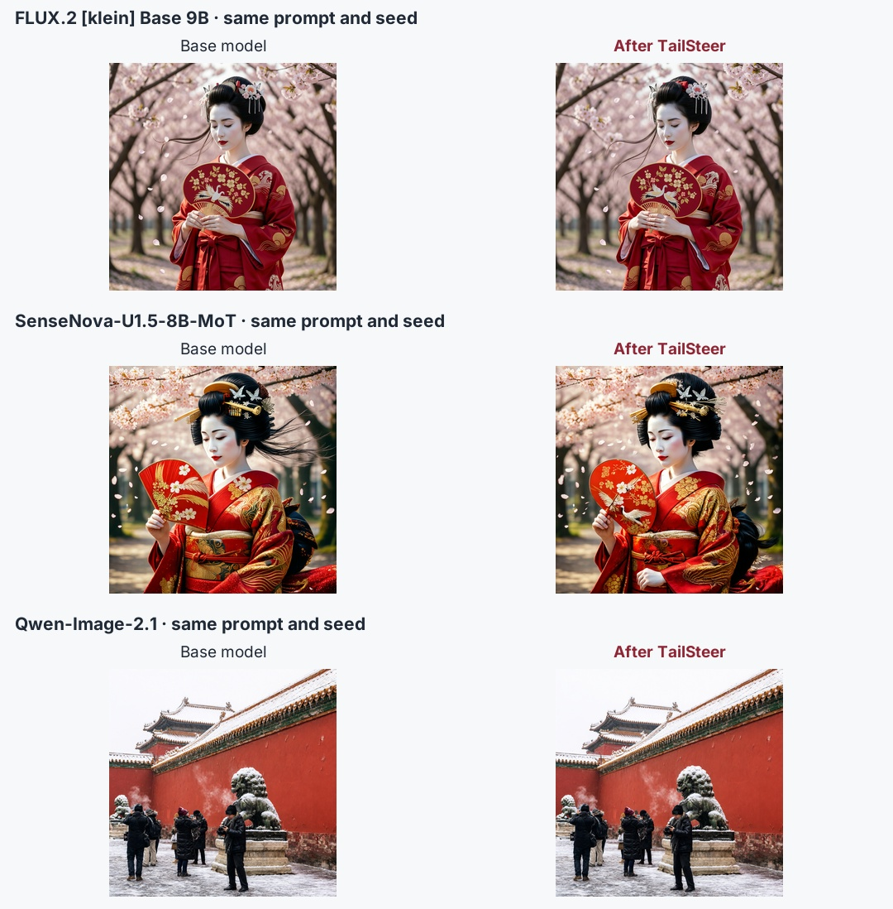
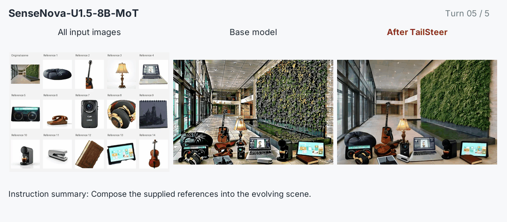
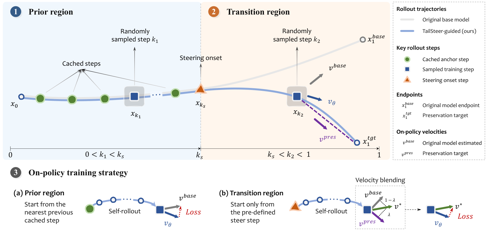

<div align="center">


# TailSteer

**Trajectory-Tail Steering for Drift-Resistant Multi-turn Image Editing**

[Ruikang Li](https://lyricccco.github.io/)<sup>1</sup> · [Zixuan Chen](https://cecret3350.github.io/)<sup>1</sup> · [Jiarui Wu](https://gnwekge78707.github.io/)<sup>1</sup> · [Mingde Yao](https://mdyao.github.io/)<sup>1</sup> · [Yiyuan Zhang](https://invictus717.github.io/)<sup>1</sup><br>
[Yujin Wang](https://openreview.net/profile?id=~Yujin_Wang2)<sup>3</sup> · [Hanming Deng](https://scholar.google.com/citations?user=NSeqMYIAAAAJ&hl=zh-CN)<sup>2</sup> · [Lewei Lu](https://scholar.google.com/citations?user=zdgKJXIAAAAJ&hl=zh-CN)<sup>2</sup> · [Tianfan Xue](https://tianfan.info/)<sup>1</sup>

<sup>1</sup> MMLab, CUHK &nbsp; <sup>2</sup> SenseTime Research &nbsp; <sup>3</sup> Shanghai Artificial Intelligence Laboratory

### [See TailSteer in action ↗](https://lyricccco.github.io/tailsteer/)

[](https://huggingface.co/spaces/hugging-apps/flux2-klein-tailsteer)

**Edit images in your browser — no local setup needed.**

<table align="center">
  <tr>
    <td align="center"><strong>A final stage after SFT, RL or OPD for multi-turn persistent editing</strong></td>
  </tr>
</table>

[](https://lyricccco.github.io/tailsteer/)

**Try the released TailSteer models**

[![FLUX.2 [klein] Base 9B · TailSteer](https://img.shields.io/badge/FLUX.2_%5Bklein%5D_Base_9B-TailSteer-692568?logo=huggingface&logoColor=FFD21E&labelColor=26323F)](https://huggingface.co/Lyricccco/FLUX.2-klein-base-9B-TailSteer)
[](https://huggingface.co/sensenova/SenseNova-U1.5-8B-MoT-TailSteer)
[](https://huggingface.co/Lyricccco/Qwen-Image-2.1-TailSteer)

[](https://arxiv.org/abs/2611.06741v1)
[](https://huggingface.co/datasets/Lyricccco/TailSteer-Source)
[](https://huggingface.co/datasets/Lyricccco/Add-and-Preserve)

[Models](#choose-your-backbone) · [Try it](#try-tailsteer) · [Reproduce](#from-source-images-to-your-own-tailsteer-model)

</div>

A strong image editor should stay strong after the first edit. **TailSteer strengthens multi-turn stability while largely retaining a foundation model's text-to-image and editing capabilities.** It is a final training stage, followed by ordinary inference with the original architecture and sampling pipeline.



*Twenty skeleton-guided dance edits on FLUX.2 [klein] Base 9B. Each branch reuses its own previous output. TailSteer follows the changing pose while reducing cumulative drift.*

**Preserve what the model knows. Steer the trajectory tail.**

- **Keep the capabilities.** Text-to-image and single-turn editing scores remain close to the base models across extensive benchmarks.
- **Keep editing.** Reduce accumulated drift in long editing chains, reference-guided motion and multi-image composition.
- **Keep your pipeline.** Complete released weights use the original official loading interface. Change the model ID or path; no adapters or new inference modules.

## See the difference across backbones



*Independent 20-turn examples from the three released models. [FLUX.2 sequence](website/assets/readme/flux2/twenty-turns.gif) · [SenseNova sequence](website/assets/readme/sensenova/twenty-turns.gif) · [Qwen sequence](website/assets/readme/qwen/twenty-turns.gif).*

### The original generation and editing strengths



*Identical prompt and seed within each pair. Selected outputs illustrate the comparison; the benchmarks below measure aggregate performance.*

**Base model → after TailSteer**, using the released 2,000-update checkpoints:

| Benchmark | FLUX.2 | SenseNova | Qwen-Image-2.1 |
|---|---:|---:|---:|
| Qwen-IB EN ↑ | 49.27 → 49.42 | 53.43 → 52.24 | 53.39 → 53.06 |
| Qwen-IB ZH ↑ | 49.16 → 49.37 | 53.25 → 52.58 | 53.34 → 53.20 |
| BizGen ES (%) ↑ | 9.87 → 10.97 | 45.85 → 45.73 | 57.03 → 57.38 |
| GEdit EN ↑ | 7.47 → 7.52 | 8.33 → 8.27 | 8.11 → 8.04 |
| GEdit ZH ↑ | 7.42 → 7.39 | 8.30 → 8.31 | 7.80 → 7.72 |
| RISE accuracy (%) ↑ | 14.17 → 13.61 | 31.39 → 29.44 | 20.56 → 18.06 |
| ImgEdit ↑ | 4.20 → 4.19 | 4.43 → 4.41 | 4.40 → 4.42 |

The gains are in stability over repeated use. Single-turn scores remain close overall, with some variation between tasks, including lower RISE accuracy at these settings.

### Better preservation, measured turn by turn

On [**Add & Preserve**](https://huggingface.co/datasets/Lyricccco/Add-and-Preserve), an editor adds objects inside a box over ten turns while everything outside should stay unchanged. COA measures requested-object presence; PSNR, SSIM and LPIPS measure preservation outside the box.

| Backbone | COA (%) ↑ | PSNR@10 ↑ | SSIM@10 ↑ | LPIPS@10 ↓ |
|---|---:|---:|---:|---:|
| FLUX.2 [klein] Base 9B | 31.02 → **31.84** | 13.85 → **19.96** | 0.289 → **0.621** | 0.524 → **0.290** |
| SenseNova-U1.5-8B-MoT | 94.93 → **94.78** | 11.23 → **18.22** | 0.166 → **0.489** | 0.607 → **0.417** |
| Qwen-Image-2.1 | 67.36 → **66.94** | 16.93 → **18.15** | 0.438 → **0.513** | 0.270 → **0.239** |

**Base → after TailSteer.** All local-model results use the same 100 images and ordinary image feedback, including VAE decode/re-encode where applicable. COA is averaged over ten turns; preservation metrics are shown at turn 10. [Metrics and curves](website/assets/readme/results.json).

### Multiple inputs, the same editor

The Ryze dance sequence above uses an ordinary subject image and pose guide at each turn. The same interface also supports scene composition from multiple reference images:



*Successive objects are introduced into an atrium with SenseNova-U1.5-8B-MoT. [Qwen pose-guided editing](website/assets/readme/qwen/multi-input.gif).*

## Try TailSteer

**Try it online:** [Open the FLUX.2 TailSteer demo](https://huggingface.co/spaces/hugging-apps/flux2-klein-tailsteer) — no local setup needed.

From the repository root, set up the backbone environment and run a demo:

```bash
python3.10 -m venv .venv
source .venv/bin/activate
pip install PyYAML
python scripts/setup.py flux2-klein-base-9b
hf auth login

tailsteer infer --backbone flux2-klein-base-9b \
  --checkpoint Lyricccco/FLUX.2-klein-base-9B-TailSteer \
  --policies tailsteer --inference-suite cafe-20turn --gpus 1
```

Already using the official pipeline? Replace its model ID with the TailSteer checkpoint. The model cards include native loading examples; **no TailSteer runtime is required** for official-pipeline inference.

To compare both models, run `tailsteer prepare model --backbone flux2-klein-base-9b` and omit `--policies tailsteer`. The default produces independent `base` / `tailsteer` chains and comparison images. Local model repositories and training inference exports are also supported.

### Choose your backbone

| Backbone | Paper training config | Complete TailSteer weights |
|---|---|---|
| FLUX.1 Kontext dev | [Kontext](configs/train/flux1-kontext-dev.yaml) | Train with the supplied configuration |
| FLUX.2 [klein] Base 9B | [Klein](configs/train/flux2-klein-base-9b.yaml) | [Download](https://huggingface.co/Lyricccco/FLUX.2-klein-base-9B-TailSteer) |
| Qwen-Image-2.1 | [Qwen](configs/train/qwen-image-2.1.yaml) | [Download](https://huggingface.co/Lyricccco/Qwen-Image-2.1-TailSteer) |
| SenseNova-U1.5-8B-MoT | [SenseNova](configs/train/sensenova-u1.5-8b-mot.yaml) | [Download](https://huggingface.co/sensenova/SenseNova-U1.5-8B-MoT-TailSteer) |

Use a separate environment for Qwen's upstream dependencies. Checkpoint access follows the Hub repository permissions and base-model terms. See [environment and model preparation](docs/preparation.md).

Four demos ship with their inputs, prompts and reference results in [demo-testset](demo-testset): a 20-turn café scene, skeleton-guided dance, object composition and people composition. `--inference-suite demos` runs the supported demos for your backbone. [Inference guide](docs/inference.md).

## How TailSteer works



**Preserve early dynamics to retain the model's priors; steer the trajectory tail toward a preservation-aware endpoint.** Training follows the editor's own on-policy denoising rollouts. Unchanged source content supplies the preservation reference, so training needs neither curated ground-truth editing pairs nor multi-turn editing chains.

At inference, the trained model runs **every denoising step** with the original sampling settings. The steering onset is a training choice, not a model switch at inference. No preservation mask, frozen teacher or velocity blending is needed during use.

## From source images to your own TailSteer model

The release includes the preparation tools, trajectory-cache generation, four paper training configurations, inference suites and benchmark adapters.

| Stage | Included | Guide |
|---|---|---|
| Prepare | Backbone-specific environments, upstream revisions and model/data downloads | [Preparation](docs/preparation.md) |
| Cache | Preservation-Aware Trajectory Cache: model rollouts, states and preservation masks | [Cache & training](docs/training.md) |
| Train | Paper defaults, distributed training, resume and inference export | [Training](docs/training.md#training) |
| Infer & evaluate | Single- and multi-image demos, chained image feedback, comparisons and benchmark scoring | [Inference](docs/inference.md) · [Evaluation](docs/evaluation.md) |

[TailSteer-Source](https://huggingface.co/datasets/Lyricccco/TailSteer-Source) supplies **11,947 images and 47,788 independent trajectory requests**. Once the environment is ready:

```bash
tailsteer prepare model --backbone flux2-klein-base-9b
tailsteer prepare training-source
tailsteer cache --backbone flux2-klein-base-9b --gpus 8
tailsteer train --backbone flux2-klein-base-9b --gpus 8 \
  --inference-suite cafe-20turn
```

The default reproduces the paper's 2,000-update schedule on eight GPUs. Change `--backbone` for another supported model. Training can automatically run your chosen inference suites after export. [Hyperparameters and trainable scope](docs/training.md).

### Evaluate the capabilities and the preservation

| Suite | Benchmarks |
|---|---|
| `t2i` | Qwen-Image-Bench, BizGenEval |
| `single-turn` | GEdit, RISE, ImgEdit |
| `multi-turn` | MSE-Bench, EdiVal |
| `add-preserve` | Add & Preserve: COA, PSNR, SSIM and LPIPS across ten turns |

Prepare each benchmark's inputs and judges with the [evaluation guide](docs/evaluation.md), then run the complete group using `--inference-suite paper-benchmarks`. The same suites work during standalone inference or automatically after training.

The public implementation has been checked against the research code for cache tensors, two-round image feedback, single-/multi-image inference and optimizer updates. Complete-model loading is also checked against the training exports. [Validation evidence and scope](docs/validation.md).

## Resources

- [Paper on arXiv](https://arxiv.org/abs/2611.06741v1)
- [Model collection](https://huggingface.co/collections/Lyricccco/tailsteer)
- [Project page: visual results and interactive comparisons](https://lyricccco.github.io/tailsteer/)
- [Source data: TailSteer-Source](https://huggingface.co/datasets/Lyricccco/TailSteer-Source) · [Add & Preserve Bench](https://huggingface.co/datasets/Lyricccco/Add-and-Preserve)
- [Dataset formats](docs/dataset-formats.md) · [Original pipeline examples](docs/model-cards)

The project page lives in [`website/`](website/README.md). README figures and model cards reuse its shared `website/assets/` files. Pushes to `main` validate and deploy the site with GitHub Pages.

## License

Code is released under [Apache 2.0](LICENSE). Backbone weights, datasets and example images retain their original terms; see [third-party sources](THIRD_PARTY.md).
