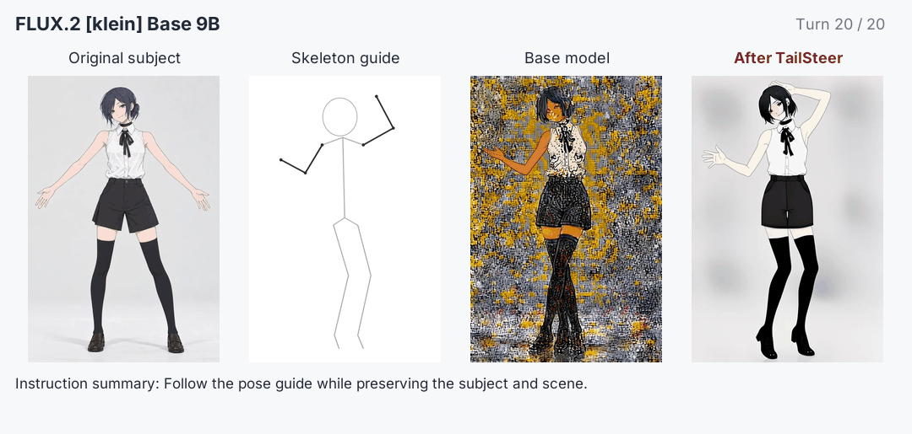
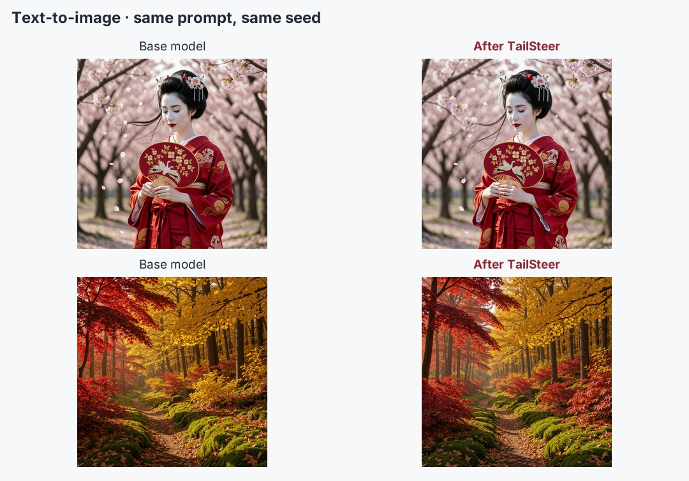
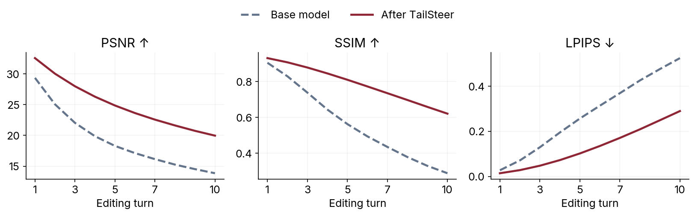

# FLUX.2 [klein] Base 9B · TailSteer

<div align="center">

[](https://huggingface.co/spaces/hugging-apps/flux2-klein-tailsteer)

**Edit images in your browser — no local setup needed.**<br>
Community demo by [hugging-apps](https://huggingface.co/hugging-apps).

</div>

### Join the TailSteer Adventure! ✨

We'd love to see what you create with TailSteer! Share your results, ideas, or feedback with us—every little creation makes our day! (≧▽≦) ♡

And if you'd like to support our work, a ⭐ on [**GitHub**](https://github.com/Lyricccco/tailsteer) or a ❤️ on [**Hugging Face**](https://huggingface.co/Lyricccco/FLUX.2-klein-base-9B-TailSteer) would mean a lot to us!

With your support, we hope to release even more TailSteer-trained models in the future! **(ง •̀ᴗ•́)ง ♡**

### Keep creating. Keep the details.

**Preserve the generation and editing strengths of FLUX.2 [klein] Base 9B. Unlock greater stability across repeated edits.** TailSteer is a final training stage that largely retains the base model's learned capabilities while reducing the drift that builds up when each edit becomes the next input.

[Try the model](#use-your-existing-pipeline) · [Single-turn results](#keep-the-foundation-models-strengths) · [Add & Preserve](https://huggingface.co/datasets/Lyricccco/Add-and-Preserve) · [Training data](https://huggingface.co/datasets/Lyricccco/TailSteer-Source)

**+6.11 dB PSNR · 44.7% lower LPIPS** outside the edit region at turn 10 on Add & Preserve.

## Reference-guided editing, turn after turn



A single character and a sequence of pose guides become twenty successive edits. TailSteer retains the subject and a cleaner background while following the changing pose. [View the final comparison](../../website/assets/readme/flux2/multi-input-last.jpg).

## A room evolves. The scene stays recognizable.


Twenty edits add and change details across a bedroom. Watch the cabinet, wall art and bed as the base model drifts and TailSteer keeps the scene coherent. Each branch feeds its own previous output into the next turn. [View the final comparison](../../website/assets/readme/flux2/twenty-turns-last.jpg) · [Prompts and frames](../../website/assets/readme/flux2/examples/editing.json).

## Use your existing pipeline

**Same architecture. Same official model layout. Same loading API.** These are complete model weights: replace your original model ID or local path with `Lyricccco/FLUX.2-klein-base-9B-TailSteer`. No adapters, merging, extra inference modules or TailSteer-specific runtime are required.

Use the same official environment as the base model. Only the model ID changes.

```python
import torch
from PIL import Image
from diffusers import Flux2KleinPipeline

pipe = Flux2KleinPipeline.from_pretrained(
    "Lyricccco/FLUX.2-klein-base-9B-TailSteer", torch_dtype=torch.bfloat16,
).to("cuda")

edited = pipe(
    image=Image.open("input.png").convert("RGB"),
    prompt="Change the jacket to blue.",
    num_inference_steps=50, guidance_scale=4.0,
    generator=torch.Generator(device="cpu").manual_seed(42),
).images[0]
edited.save("output.png")
```


For the next edit, pass the edited image back into the same pipeline. Use TailSteer throughout the original denoising trajectory; no model switching or preservation mask is needed at inference.

## Keep the foundation model's strengths



*Same prompt and seed in each pair. [Full prompts and images](../../website/assets/readme/flux2/examples/text-to-image.json).*

The same checkpoint supports text-to-image generation and single-turn editing. Across Qwen-Image-Bench, BizGenEval, GEdit and ImgEdit, scores stay close to the base model. The table includes RISE as well, where accuracy is lower in this setting.

| Benchmark | Base model | After TailSteer |
|---|---:|---:|
| Qwen-IB EN ↑ | 49.27 | 49.42 |
| Qwen-IB ZH ↑ | 49.16 | 49.37 |
| BizGen ES (%) ↑ | 9.87 | 10.97 |
| GEdit EN ↑ | 7.47 | 7.52 |
| GEdit ZH ↑ | 7.42 | 7.39 |
| RISE accuracy (%) ↑ | 14.17 | 13.61 |
| ImgEdit ↑ | 4.20 | 4.19 |

## Measure what stays unchanged

[**Add & Preserve**](https://huggingface.co/datasets/Lyricccco/Add-and-Preserve) makes drift visible: add a small object inside the red box at each turn, retain previous objects, and preserve everything outside. It tests both object completion and background preservation across 100 images and ten turns.



| Model | COA (%) ↑ | PSNR@10 ↑ | SSIM@10 ↑ | LPIPS@10 ↓ |
|---|---:|---:|---:|---:|
| Base model | 31.02 | 13.85 | 0.289 | 0.524 |
| After TailSteer | 31.84 | 19.96 | 0.621 | 0.290 |

COA (Cumulative Object Accuracy) averages requested-object presence across ten turns. PSNR, SSIM and LPIPS measure the unchanged region. These are standard image-feedback results; curves use all 100 images. [Metric data](../../website/assets/readme/flux2/results.json).

## Run demos and benchmarks

With the TailSteer codebase installed in the official backbone environment:

```bash
tailsteer infer --backbone flux2-klein-base-9b \
  --checkpoint Lyricccco/FLUX.2-klein-base-9B-TailSteer \
  --policies tailsteer --inference-suite cafe-20turn --gpus 1
```

Prepare the original base weights and omit `--policies tailsteer` for side-by-side comparisons. The same suite interface runs text-to-image, single-turn editing, multi-turn editing and Add & Preserve benchmarks after their datasets and judges are configured.

## How TailSteer works

**Preserve early dynamics; steer the trajectory tail.** TailSteer learns from the editor's own denoising rollouts, using unchanged source content as a preservation reference. It improves long-horizon stability using single-edit trajectories, without requiring curated ground-truth editing pairs or training on multi-turn editing chains.

This is the paper's **2,000-update checkpoint**, with training steering onset **46 / 50**. The onset controls training supervision; inference uses the trained model at every step. The packaged model was [validated against the original inference export](../validation.md).

From *TailSteer: Trajectory-Tail Steering for Drift-Resistant Multi-turn Image Editing*.

The [base model](https://huggingface.co/black-forest-labs/FLUX.2-klein-base-9B) license and attribution apply: [LICENSE.md](https://huggingface.co/Lyricccco/FLUX.2-klein-base-9B-TailSteer/blob/main/LICENSE.md) · [NOTICE](https://huggingface.co/Lyricccco/FLUX.2-klein-base-9B-TailSteer/blob/main/NOTICE).
