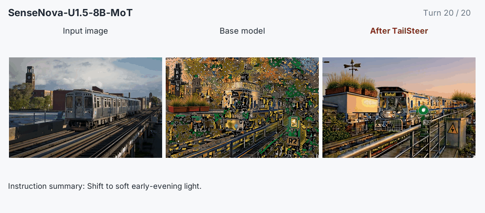
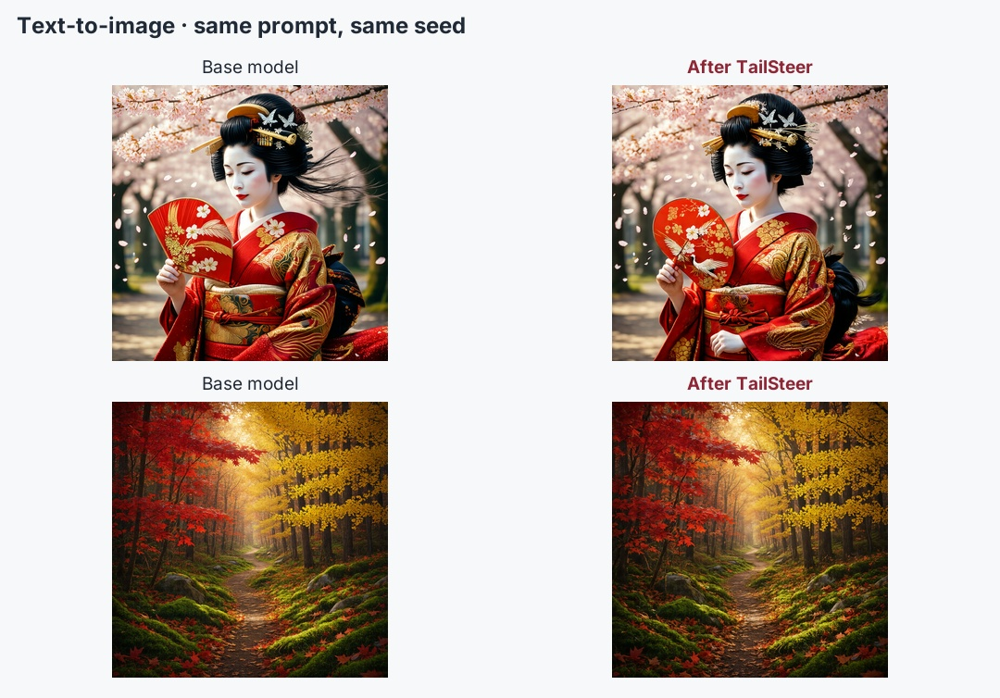
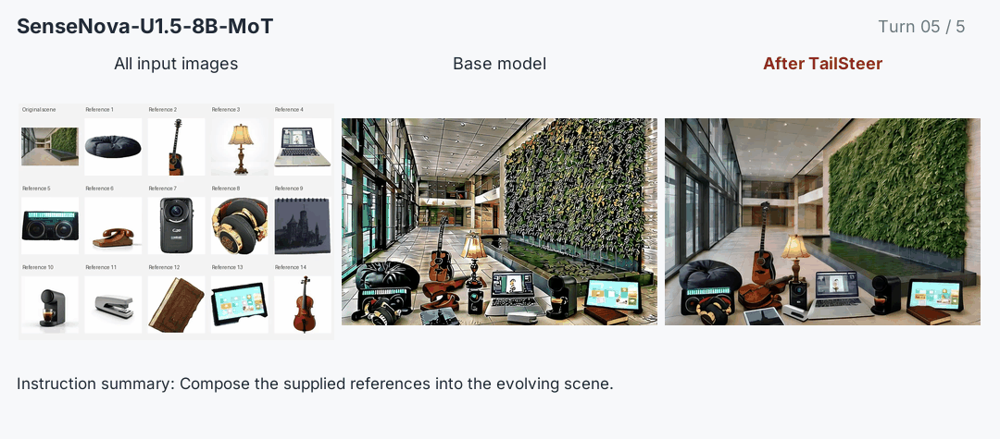
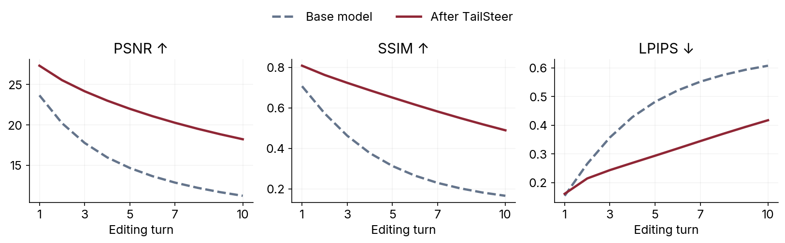

# SenseNova-U1.5-8B-MoT · TailSteer

### Join the TailSteer Adventure! ✨

We'd love to see what you create with TailSteer! Share your results, ideas, or feedback with us—every little creation makes our day! (≧▽≦) ♡

If you'd like to support our work, a ⭐ on [**GitHub**](https://github.com/Lyricccco/tailsteer) or a ❤️ on [**Hugging Face**](https://huggingface.co/sensenova/SenseNova-U1.5-8B-MoT-TailSteer) would mean a lot—and stay tuned to our GitHub repo for future TailSteer-trained model releases! **(ง •̀ᴗ•́)ง ♡**

### Keep creating. Keep the details.

**Preserve the generation and editing strengths of SenseNova-U1.5-8B-MoT. Unlock greater stability across repeated edits.** TailSteer is a final training stage that largely retains the base model's learned capabilities while reducing the drift that builds up when each edit becomes the next input.

[Try the model](#use-your-existing-pipeline) · [Single-turn results](#keep-the-foundation-models-strengths) · [Add & Preserve](https://huggingface.co/datasets/Lyricccco/Add-and-Preserve) · [Training data](https://huggingface.co/datasets/Lyricccco/TailSteer-Source)

**+6.99 dB PSNR · 31.3% lower LPIPS** outside the edit region at turn 10 on Add & Preserve.

## Keep building the scene. Keep its structure.



Twenty instructions transform an elevated railway scene. TailSteer keeps the train, tracks and city legible as the base model accumulates texture artifacts. Each branch feeds its own previous output into the next turn. [View the final comparison](../../website/assets/readme/sensenova/twenty-turns-last.jpg) · [Prompts and frames](../../website/assets/readme/sensenova/examples/editing.json).

## Use your existing pipeline

**Same architecture. Same official model layout. Same loading API.** These are complete model weights: replace your original model ID or local path with `sensenova/SenseNova-U1.5-8B-MoT-TailSteer`. No adapters, merging, extra inference modules or TailSteer-specific runtime are required.

Use the same official environment as the base model. Only the model ID changes.

With the [official SenseNova inference package](https://github.com/OpenSenseNova/SenseNova-U1):

```bash
python examples/editing/inference.py \
  --model_path sensenova/SenseNova-U1.5-8B-MoT-TailSteer \
  --image input.png --prompt "Change the jacket to blue." --output output.png
```


For the next edit, pass the edited image back into the same pipeline. Use TailSteer throughout the original denoising trajectory; no model switching or preservation mask is needed at inference.

## Keep the foundation model's strengths



*Same prompt and seed in each pair. [Full prompts and images](../../website/assets/readme/sensenova/examples/text-to-image.json).*

The same checkpoint supports text-to-image generation and single-turn editing. Across Qwen-Image-Bench, BizGenEval, GEdit and ImgEdit, scores stay close to the base model. The table includes RISE as well, where accuracy is lower in this setting.

| Benchmark | Base model | After TailSteer |
|---|---:|---:|
| Qwen-IB EN ↑ | 53.43 | 52.24 |
| Qwen-IB ZH ↑ | 53.25 | 52.58 |
| BizGen ES (%) ↑ | 45.85 | 45.73 |
| GEdit EN ↑ | 8.33 | 8.27 |
| GEdit ZH ↑ | 8.30 | 8.31 |
| RISE accuracy (%) ↑ | 31.39 | 29.44 |
| ImgEdit ↑ | 4.43 | 4.41 |

## Compose objects without rebuilding the scene



The same editor also accepts multiple reference images. Here, successive objects are introduced into an atrium while TailSteer better preserves the evolving scene. [View the final comparison](../../website/assets/readme/sensenova/multi-input-last.jpg).

## Measure what stays unchanged

[**Add & Preserve**](https://huggingface.co/datasets/Lyricccco/Add-and-Preserve) makes drift visible: add a small object inside the red box at each turn, retain previous objects, and preserve everything outside. It tests both object completion and background preservation across 100 images and ten turns.



| Model | COA (%) ↑ | PSNR@10 ↑ | SSIM@10 ↑ | LPIPS@10 ↓ |
|---|---:|---:|---:|---:|
| Base model | 94.93 | 11.23 | 0.166 | 0.607 |
| After TailSteer | 94.78 | 18.22 | 0.489 | 0.417 |

COA (Cumulative Object Accuracy) averages requested-object presence across ten turns. PSNR, SSIM and LPIPS measure the unchanged region. These are standard image-feedback results; curves use all 100 images. [Metric data](../../website/assets/readme/sensenova/results.json).

## Run demos and benchmarks

With the TailSteer codebase installed in the official backbone environment:

```bash
tailsteer infer --backbone sensenova-u1.5-8b-mot \
  --checkpoint sensenova/SenseNova-U1.5-8B-MoT-TailSteer \
  --policies tailsteer --inference-suite cafe-20turn --gpus 1
```

Prepare the original base weights and omit `--policies tailsteer` for side-by-side comparisons. The same suite interface runs text-to-image, single-turn editing, multi-turn editing and Add & Preserve benchmarks after their datasets and judges are configured.

## How TailSteer works

**Preserve early dynamics; steer the trajectory tail.** TailSteer learns from the editor's own denoising rollouts, using unchanged source content as a preservation reference. It improves long-horizon stability using single-edit trajectories, without requiring curated ground-truth editing pairs or training on multi-turn editing chains.

This is the paper's **2,000-update checkpoint**, with training steering onset **42 / 50**. The onset controls training supervision; inference uses the trained model at every step. The packaged model was [validated against the original inference export](../validation.md).

From *TailSteer: Trajectory-Tail Steering for Drift-Resistant Multi-turn Image Editing*.

The [base model](https://huggingface.co/sensenova/SenseNova-U1.5-8B-MoT) license and attribution apply: [LICENSE](https://huggingface.co/sensenova/SenseNova-U1.5-8B-MoT-TailSteer/blob/main/LICENSE) · [NOTICE](https://huggingface.co/sensenova/SenseNova-U1.5-8B-MoT-TailSteer/blob/main/NOTICE).
